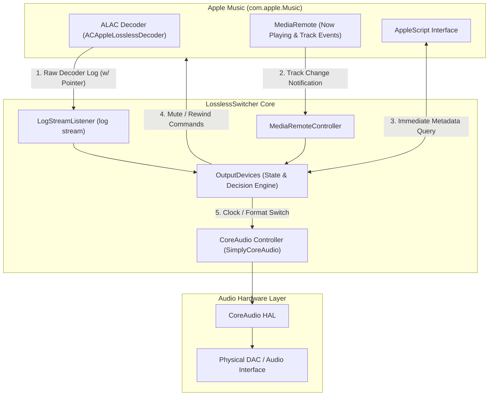

<p align="center">
  
</p>

#  

LosslessSwitcher switches your current audio device's sample rate to match the currently playing lossless song on your Apple Music app, automatically.

Let's say if the next song that you are playing, is a Hi-Res Lossless track with a sample rate of 192kHz, LosslessSwitcher will switch your device to that sample rate as soon as possible. 

The opposite happens, when the next track happens to have a lower sample rate. 

## Installation

### For macOS Big Sur 11.4 to macOS Sonoma 14.x
Please use releases of version 1.x, such as versions 1.0, 1.1 or [1.1.1 betas](https://github.com/vincentneo/LosslessSwitcher/releases/tag/1.1.1-beta2).
Version 1.x also works up to macOS Sequoia 15.3.1.

You can find the latest stable release of the version 1.x branch here: [Link to v1.1](https://github.com/vincentneo/LosslessSwitcher/releases/tag/1.1.0)

### For macOS Sequoia 15.4 and macOS Tahoe (macOS 26+) onwards
Please use version 4.0 or later. It is fully updated with support for macOS Sequoia and macOS Tahoe, featuring a highly optimized event-driven core.

#### Steps
1. Download the preferred version release.
2. Drag the app to your Applications folder.

If you wish to have it running when logging in, you should be able to add LosslessSwitcher in System Settings:
```
> User & Groups > Login Items > Add LosslessSwitcher app
```

## Prerequisites
Due to how the app works, this app is not, and cannot be sandboxed.
It also has the following requirements:
- The user running LosslessSwitcher must be an **admin** (required to read the system log stream).
- Apple Music app must have Lossless mode enabled.
- Apple Music's **Crossfade** (under Music > Settings > Playback) must be turned **off** (blending songs will conflict with the physical DAC clock switching and mute-sync logic).

Other than that, it should run on any Mac running macOS 11.4 or later.

## How It Works & Core Architecture

Unlike iOS, macOS does not automatically switch your audio output device's hardware sample rate to match the currently playing song in Apple Music. Instead, Apple Music forces CoreAudio to resample (SRC) the audio stream to whatever fixed rate is set in Audio MIDI Setup.

LosslessSwitcher bridges this gap with an event-driven architecture that coordinates Apple Music, CoreAudio HAL, and macOS Unified Logging.



### The Three Core Pillars

1. **4-Tier Fast Detection Pipeline**
   - **Tier 1: Pre-buffer Pending (0ms)**: Applies the pre-buffered format immediately at the exact instant of track transition.
   - **Tier 2: Memory Cache (0ms)**: Recalls known format from in-memory cache for previously played songs.
   - **Tier 3: AppleScript Fast Query (~50–100ms)**: Queries track metadata immediately upon track change when no pre-buffer exists (e.g. manual track skipping).
   - **Tier 4: Real-time Decoder Logging (OSLog)**: Captures exact bit depth (e.g., 24-bit source) and handles adaptive streaming upgrades.

2. **Decoder Instance Tracking (Next-Track Isolation)**
   - Apple Music pre-buffers upcoming tracks in the background. LosslessSwitcher tracks the memory address (pointer) of the active `ACAppleLosslessDecoder` instance.
   - Incoming formats from separate decoder instances are automatically identified as upcoming tracks and deferred to `pendingTargetSampleRate` without interrupting the current track.

3. **Mute-Sync-Rewind Sequence**
   - DAC clock re-locking often produces physical relay clicks or pop noises.
   - LosslessSwitcher executes a synchronized sequence: **Mute Music app ➔ Switch DAC clock ➔ Wait for hardware lock (polling every 20ms) ➔ Rewind to 00:00 (if within 5s) ➔ Unmute**. This guarantees pop-free transitions and zero audio cutoff.

## App details

LosslessSwitcher runs quietly in your menu bar. The main mechanisms of the app are:
1. **Real-time Log Monitoring**: The app monitors system log events to detect the active song's sample rate and bit depth immediately when it starts loading.
2. **Audio Output Synchronization**: Sets the matching sample rate on your active audio output device.
3. **Mute/Rewind Logic**: Automatically silences the audio output during physical DAC format switching to prevent pops or clicks, and ensures the song starts playing from the very beginning.

As such, the app is extremely lightweight and operates with minimal CPU usage.


If you wish, the sample rate can also be directly visible as the menu bar item.


Do also note that:
- There may be a short silent pause during track transitions as the DAC reconfigures its clocks.
- Battery impact is negligible starting from version 4.0, as all periodic log database querying has been replaced with event-driven streaming.

Bit Depth switching is also supported, although, enabling it will reduce detection accuracy, hence, it is not recommended.

### Why make this?
Ever since Apple Music Lossless launched along with macOS 11.4, the app would never switch the sample rates according to the song that was playing. A trip down to the Audio MIDI Setup app was required.
This still happens today, with macOS 12.3.1, despite iOS's Music app having such an ability.

I think this improvement might be well appreciated by many, hence this project is here, free and open source.

## Disclaimer
By using LosslessSwitcher, you agree that under no circumstances will the developer or any contributors be held responsible or liable in any way for any claims, damages, losses, expenses, costs or liabilities whatsoever or any other consequences suffered by you or incurred by you directly or indirectly in connection with any form of usages of LosslessSwitcher.

Do note that Steven Slate Audio VSX software may not be fully compatible with LosslessSwitcher, and both software may interfere with each other. Please refer to discussion https://github.com/vincentneo/LosslessSwitcher/discussions/100 for more information.

## License
LosslessSwitcher is licensed under GPL-3.0.

## Love the idea of this?
If you appreciate the development of this application, feel free to spread the word around so more people get to know about LosslessSwitcher. 
You can also show your support by [sponsoring](https://github.com/sponsors/vincentneo) this project!

## Dependencies
- [Sweep](https://github.com/JohnSundell/Sweep), by @JohnSundell, an easy to use Swift `String` scanner.
- [SimplyCoreAudio](https://github.com/rnine/SimplyCoreAudio), by @rnine, a framework that makes `CoreAudio` so much easier to use.
- [PrivateMediaRemote](https://github.com/PrivateFrameworks/MediaRemote), by @DimitarNestorov, in order to use private media remote framework.
