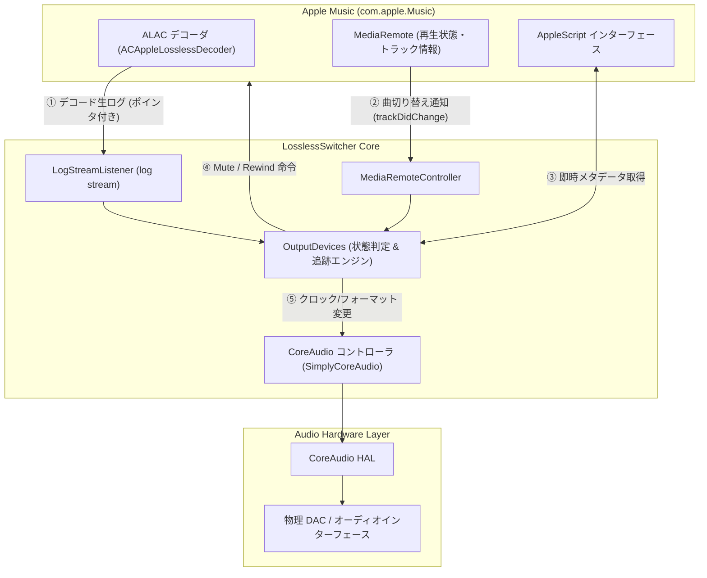
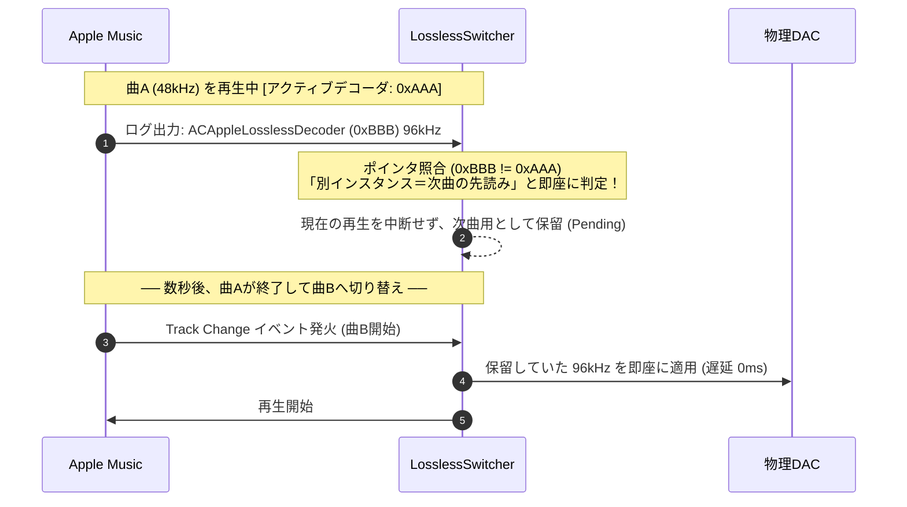

# LosslessSwitcher 設計思想と動作原理の解説

LosslessSwitcher は、macOS 版 Apple Music において**「楽曲本来のネイティブなサンプリングレート・ビット深度（ビットパーフェクト）で DAC を自動駆動させる」**ために設計されたユーティリティです。

本ドキュメントでは、macOS のオーディオ構造上の制約から、本アプリがどのようにそれを解決しているのか、その設計思想と動作原理を図解を交えて解説します。

---

## 1. 設計思想：なぜこのアプリが必要なのか？

### macOS Apple Music の構造的ジレンマ
iOS のミュージックアプリは、接続された DAC に対して楽曲のサンプリング周波数（44.1kHz〜192kHz）を自動で追従・変更します。
しかし、macOS の Apple Music にはその機能がなく、**「Audio MIDI 設定」で固定されたハードウェアレートへ、アプリ内部で強制リサンプリング（SRC）して出力する仕様**になっています。

```text
【macOS標準の挙動（DACが48kHz固定の場合）】
[ 192kHz ハイレゾ音源 ]
       │
       ▼
[ Apple Music 内部 (AVPlayer) ] ── (48kHz へ強制ダウンサンプリング)
       │
       ▼
[ 物理 DAC (48kHz) ] ◀── せっかくのハイレゾ音源が活かされない
```

ユーザーが手動で「Audio MIDI 設定」を開いて毎曲切り替える手間をなくし、**「再生が始まった瞬間に、OS とハードウェアを完全に調律してビットパーフェクト再生を実現する」**ことが本アプリの思想です。

---

## 2. 全体アーキテクチャ図

本アプリは、Apple Music の再生状態、CoreAudio HAL（ハードウェア抽象化レイヤー）、そして macOS 統一ログシステム（OSLog）の3つを統合制御するオーケストレーターとして動作します。



---

## 3. コア機構の3つの柱

### 柱①：超低遅延を叶える「4段フォールバック検知」
曲が変わった瞬間、Apple Music が通信やデコードを行うのを待たずに、最速で DAC を追従させるための階層構造です。

1. **第1層：先行保留（Pending / 0ms）**  
   前の曲の再生中に次の曲が先読み（プリフェッチ）されていれば、曲が変わった瞬間に即時適用。
2. **第2層：楽曲キャッシュ（Memory Cache / 0ms）**  
   過去に一度再生した曲（リピートや既知の曲）なら、メモリ内の辞書から即時適用。
3. **第3層：AppleScript メタデータ即時取得（~50-100ms）**  
   先読みもキャッシュもない手動スキップ時、曲変更トリガーで即座に AppleScript からメタデータを取得して即時切り替え。
4. **第4層：デコーダ生ログ（OSLog Streaming）**  
   通信完了後にデコーダから届く詳細ログ（ビット深度 24bit 等）で、最終的な整合性を高精度に同期。

---

### 柱②：デコーダ・インスタンス分離（先読み誤爆の完全防止）
Apple Music は曲の終盤や「次に再生」追加時に、**次曲のデータをバックグラウンドで先読み（プリフェッチ）**します。
これまでの課題であった「曲の演奏中に次の曲のレートへ勝手に切り替わってしまう問題」を、**デコーダのメモリアドレス（ポインタ）追跡**により根本解決しました。



---

### 柱③：ノイズフリー ＆ 頭欠け防止（Mute-Sync-Rewind）
DAC がハードウェアクロック（44.1kHz系 $\leftrightarrow$ 48kHz系など）を切り替える瞬間には、物理的な「プチッ」というリレー音やポップノイズが発生し、クロック安定化までに数百ミリ秒の無音・同期ラグが生じます。

これを防ぎ、曲の先頭を1音も逃さず美しく鳴らすために、**ミリ秒単位の同調シークエンス**を実行します。


- **Mute**: クロック切り替え時のポップノイズを完全に遮断。
- **Rewind**: DAC が同期する間に進んでしまった冒頭（コンマ数秒）を先頭（0秒地点）へ巻き戻す。
- **Unmute**: 完全なクロック同期状態で、楽曲の先頭から一切の欠落なくリスナーに音を届ける。

---

## 4. 思想のまとめ

LosslessSwitcher の本質は、単なる「サンプリングレート変更ツール」ではなく、
**「macOS のリサンプル仕様の隙間を埋め、DAC のハードウェア制約（ノイズ・切り替えラグ）を感じさせず、Apple Music を据え置き型高級ネットワークトランスポートと同等のビットパーフェクト再生環境へ昇華させるブリッジ」**
にあります。